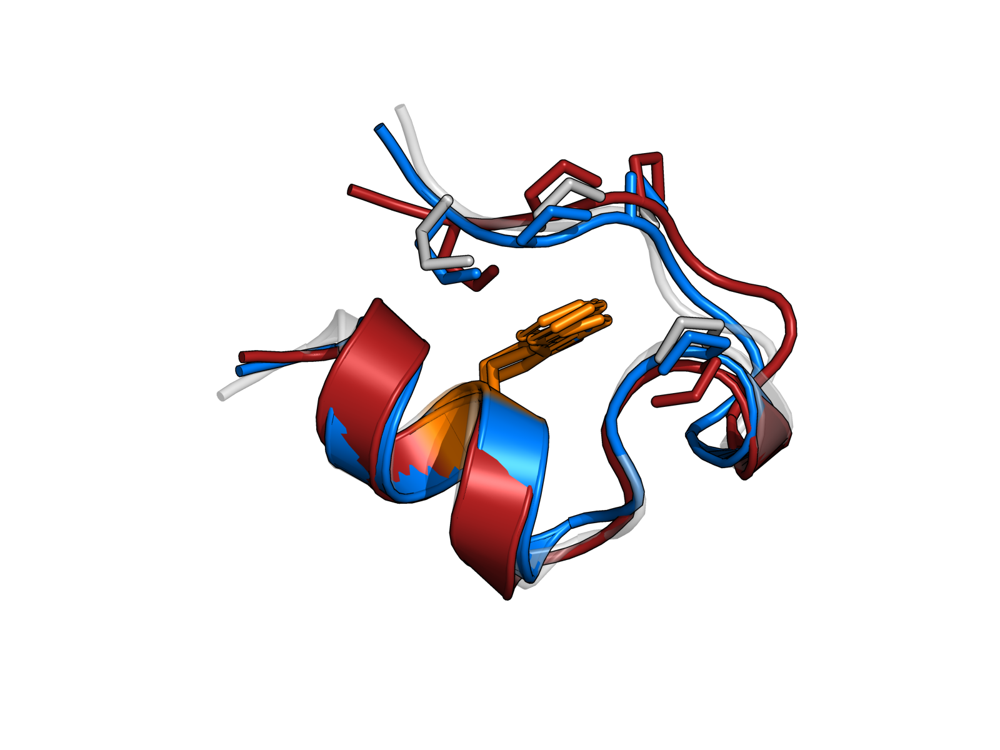
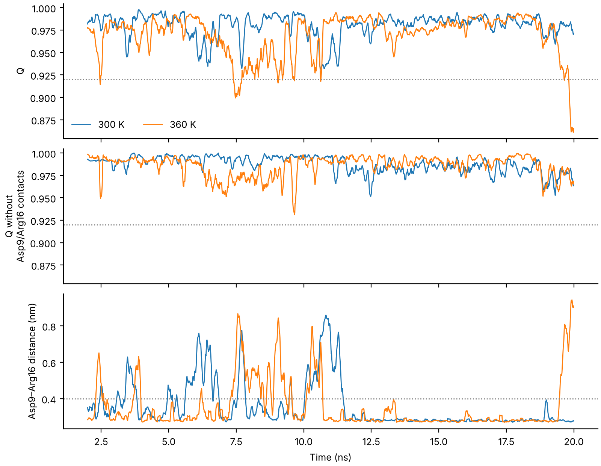
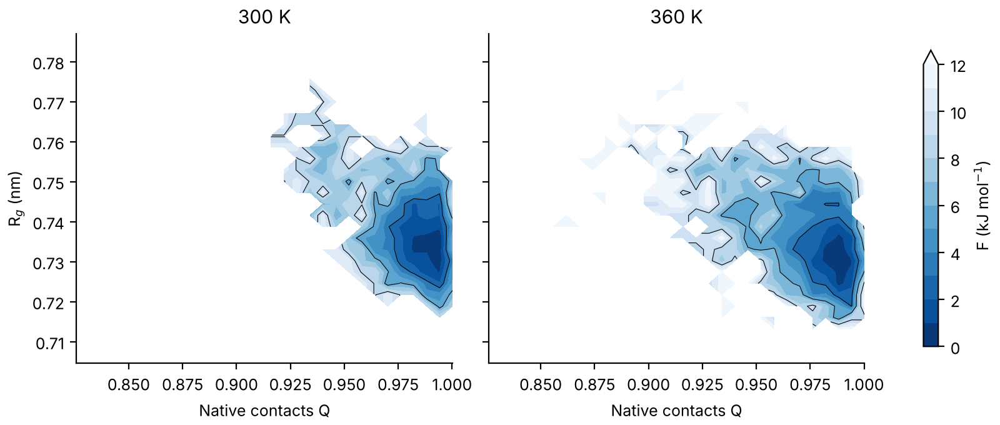
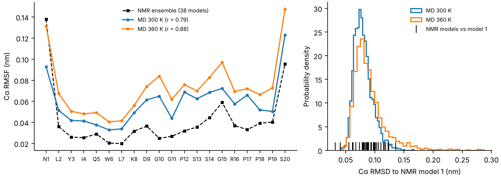

# Thermal stability of the Trp-cage mini-protein

All-atom molecular dynamics of Trp-cage (PDB [1L2Y](https://www.rcsb.org/structure/1L2Y), 20 residues) in explicit water at **300 K and 360 K**. The ensembles are analysed with free-energy landscapes, validation against the experimental NMR ensemble, salt-bridge and contact analysis, block-averaged statistics and an interpretable machine-learning classifier.

<p align="center"><br>
<em>Final frames at 300 K (blue) and 360 K (red) on the native NMR structure (grey); Trp6 in orange.</em></p>

## Key findings

| | 300 K | 360 K | *p* |
|---|---|---|---|
| Cα RMSD (nm) | 0.083 ± 0.002 | 0.095 ± 0.002 | < 0.001 |
| Radius of gyration (nm) | 0.738 ± 0.002 | 0.737 ± 0.002 | 0.74 |
| Native contacts Q | 0.980 ± 0.002 | 0.970 ± 0.005 | 0.08 |
| Helical fraction (DSSP) | 0.535 ± 0.003 | 0.529 ± 0.003 | 0.24 |
| Trp6 SASA (nm²) | 0.20 ± 0.01 | 0.22 ± 0.01 | 0.36 |

<sub>Mean ± SEM from block averaging (10 × 1.8 ns, t = 2–20 ns); Welch *t*-test on block means.</sub>

1. **The simulation reproduces experiment.** 99.5% of 300 K frames lie within the Cα RMSD spread of the 38-model NMR ensemble, and per-residue flexibility correlates with the NMR ensemble (r = 0.79 at 300 K, 0.88 at 360 K).
2. **Heating broadens the native basin but does not unfold the protein** within 20 ns. Only the RMSD changes significantly; the free-energy landscape keeps a single basin.
3. **The Asp9–Arg16 salt bridge is the first interaction to give way.** At 360 K the salt bridge is open in 95% of the frames where native contacts dip (Q < 0.92), compared with 17% of the other frames. When contacts involving these two residues are removed from Q, the dips almost disappear: the hydrophobic Trp6 cage stays intact.
4. **The ensembles overlap heavily.** A logistic-regression classifier on Cα–Cα distances, cross-validated on held-out time blocks, reaches a balanced accuracy of only 0.62. The distances it relies on point to the N-terminus/polyproline packing and the Asp9–Arg16 loop.

<p align="center"><br>
<em>Dips in Q (top) coincide with openings of the Asp9–Arg16 salt bridge (bottom) and vanish when those contacts are excluded (middle).</em></p>

<p align="center"><br>
<em>Free-energy landscapes F(Q, R<sub>g</sub>) = −k<sub>B</sub>T ln P: one native basin at both temperatures, broader at 360 K.</em></p>

<p align="center"><br>
<em>Validation against the NMR ensemble: per-residue RMSF (left) and Cα RMSD to NMR model 1 (right).</em></p>

## Methods

| | |
|---|---|
| Engine | OpenMM 8 (CUDA, Google Colab T4 GPU, ~1100 ns/day) |
| Force field | AMBER ff14SB, TIP3P-FB water, 0.15 M NaCl, 1.0 nm padding |
| Integration | Langevin middle integrator, 4 fs step with hydrogen-mass repartitioning (1.5 amu), H-bond constraints, PME |
| Ensemble | NPT, 1 bar; 200 ps heavy-atom-restrained equilibration, then 20 ns production per temperature |
| Descriptors | MDTraj: Cα RMSD, R<sub>g</sub>, native contacts Q (Best–Hummer–Eaton), DSSP, RMSF, Trp6 SASA, residue contact maps, Asp9–Arg16 distance |
| Statistics | Block averaging with SEM-versus-block-length convergence check; Welch *t*-test on block means |
| Machine learning | PCA and free-energy surfaces; L2 logistic regression on 190 Cα–Cα distances with blocked cross-validation (no leakage between correlated frames) |

## Repository

| Path | Content |
|---|---|
| `trpcage_md.ipynb` | Full write-up with code, outputs and discussion (runs on Google Colab) |
| `simulate.py` | System setup, minimization, equilibration and production (OpenMM) |
| `analyze.py` | Basic descriptors: time series, RMSF, PCA |
| `analyze_advanced.py` | Free-energy landscapes, NMR validation, salt bridge and excursions, contacts, SASA, classifier, block statistics; supports replicas |
| `render_pymol.py` | Publication-quality structure images |
| `runs/` | Protein-only trajectories (XTC, 10 ps sampling) and starting structures |
| `results/`, `results_advanced/`, `images/` | Figures, summary tables and `report.json` with all numbers |

## Reproduce

```bash
pip install -r requirements.txt        # PyMOL optional: pip install pymol-open-source-whl
wget https://files.rcsb.org/download/1L2Y.pdb

# simulations (GPU recommended; ~30 min each on a T4)
python simulate.py --pdb 1L2Y.pdb --temp 300 --ns 20 --out runs/T300 --seed 11
python simulate.py --pdb 1L2Y.pdb --temp 360 --ns 20 --out runs/T360 --seed 12

# analysis (the trajectories in runs/ are included, so this works without re-simulating)
python analyze.py runs/T300 runs/T360 --labels "300 K" "360 K" --out results
python analyze_advanced.py --group 300 runs/T300 --group 360 runs/T360 --nmr 1L2Y.pdb --out results_advanced
```

With replicas, list them per temperature: `--group 300 runs/T300 runs/T300_r2 runs/T300_r3`. The uncertainties then come from the spread between replicas, and the classifier uses leave-one-replica-out validation.

## Limitations and next steps

- One 20 ns trajectory per temperature. The block-averaging check shows that the 360 K uncertainties are lower bounds, so the next step is **3+ replicas per temperature**.
- 20 ns is far shorter than Trp-cage's microsecond folding time, so no statements are made about the unfolded state or the melting temperature. Longer runs, higher temperatures (NVT) or replica-exchange MD would be needed.
- A D9N or R16A in-silico mutant would test the salt-bridge mechanism directly.

## How AI tools were used

The code was developed with AI-assisted programming (Claude): drafting scripts, debugging and documentation. I ran the simulations, checked every analysis step against the data, and interpreted the results.

## References

Neidigh et al., *Nat. Struct. Biol.* 9, 425 (2002) · Qiu et al., *JACS* 124, 12952 (2002) · Barua et al., *PEDS* 21, 171 (2008) · Best, Hummer & Eaton, *PNAS* 110, 17874 (2013) · Lindorff-Larsen et al., *Science* 334, 517 (2011) · Maier et al., *JCTC* 11, 3696 (2015) · Eastman et al., *PLoS Comput. Biol.* 13, e1005659 (2017) · McGibbon et al., *Biophys. J.* 109, 1528 (2015) · Hopkins et al., *JCTC* 11, 1864 (2015)
